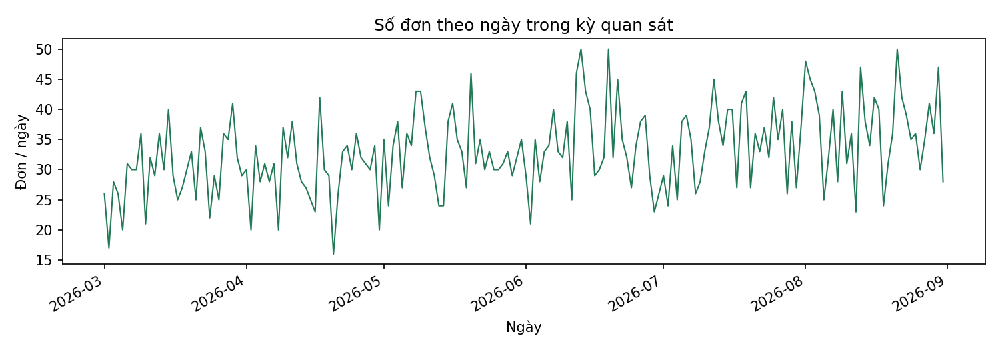
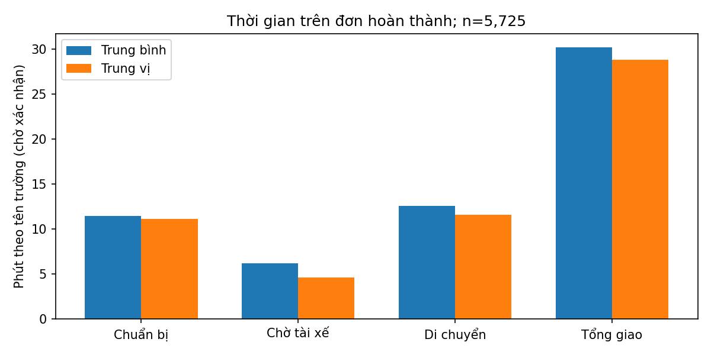
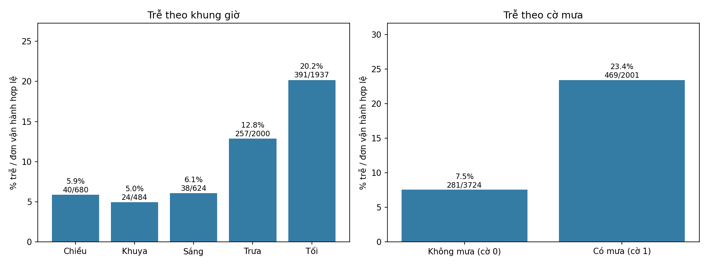

# Hiểu dữ liệu GiaoNong — Phase 1 mới

Đã tính lại từ CSV gốc và dừng trước làm sạch. Gate 1 chưa được duyệt.

## Cách đọc

Sổ đơn hàng có dòng đơn, ô thông tin và các nhóm. `n` là số ô/đơn dùng được; mẫu số (denominator) là số đối tượng đem so; độ phủ (coverage) là phần có đủ dữ liệu. Không xuất mã khách hoặc từng giao dịch.

## Nguồn và mức độ xác nhận

Nguồn đọc: `E:\Practice_DSEA\DA\OpenSrcDA\data\giaongon_orders_2026.csv`. SHA-256: `4c967c8bcbecebe44ff542bb4f3722630ab62e1cfa93264e1984ae998680fe4c`.

- Metadata: chỉ có header CSV; chưa thấy dictionary độc lập về tiền, đơn vị hoặc SLA.
- Quan sát: kỳ, dòng, nhãn, ô trống, số tài chính và thời gian được đo mới.
- Quy tắc dự án: CLAUDE giữ ô vận hành trống ở đơn hủy; legacy `02_build_curated.py` gọi cờ hủy 0 là hoàn thành. Chỉ dùng để đối chiếu, không chạy script cũ.
- Giả thuyết kiểm: công thức/ID/thang điểm từ legacy `01_profile_data.py`; nguồn số khớp không tự xác nhận nghiệp vụ.

## Sáu câu hỏi

### 1. Lượng đơn theo thời gian

Mỗi dòng có một mã đơn riêng; ghi nhận 0 dòng trùng toàn bộ. Kỳ quan sát 2026-03-01 đến 2026-08-31, có 184 ngày có đơn và 0 ngày thiếu bên trong kỳ. Đây là kỳ thấy trong sổ, không phải ngày chụp hay toàn lịch sử kinh doanh.

| group | orders | cancel_n | cancel_denominator | late_n | late_denominator |
|---|---|---|---|---|---|
| 2026-03 | 920 | 32 | 920 | 53 | 888 |
| 2026-04 | 886 | 24 | 886 | 40 | 862 |
| 2026-05 | 1029 | 30 | 1029 | 124 | 999 |
| 2026-06 | 1028 | 39 | 1028 | 126 | 989 |
| 2026-07 | 1066 | 76 | 1066 | 157 | 990 |
| 2026-08 | 1144 | 147 | 1144 | 250 | 997 |

### 2. Hủy và trễ

Có 348/6,073 đơn mang cờ hủy (5.73%). Trễ là 750/5,725 đơn đủ thông tin vận hành (13.10%). 5,725 đơn cờ 0 được gọi là hoàn thành theo quy tắc dự án; các ô trống của đơn hủy vẫn giữ trống. Cờ trễ chưa cho biết ngưỡng cam kết giao hàng.

| cohort | n | prep_min_missing | rider_wait_min_missing | travel_min_missing | delivery_min_missing | is_late_missing | rating_missing | cancel_reason_missing |
|---|---|---|---|---|---|---|---|---|
| completed | 5725 | 0 | 0 | 0 | 0 | 0 | 0 | 5725 |
| cancelled | 348 | 0 | 0 | 348 | 348 | 348 | 348 | 0 |
| unknown | 0 | 0 | 0 | 0 | 0 | 0 | 0 | 0 |

| column | labels |
|---|---|
| cancel_reason | {'<missing>': 5725, 'Chờ tài xế quá lâu': 198, 'Khách đổi ý': 73, 'Nhà hàng hết món': 45, 'Sai địa chỉ': 32} |

### 3. Thời gian ở từng bước

Bảng thời gian chỉ dùng đơn cờ hủy bằng 0 có thời gian không âm và hữu hạn; n là số đơn dùng được. prep_min: trung bình 11.47, trung vị 11.10, n=5,725; rider_wait_min: trung bình 6.17, trung vị 4.60, n=5,725; travel_min: trung bình 12.59, trung vị 11.60, n=5,725; delivery_min: trung bình 30.22, trung vị 28.80, n=5,725. Trung bình giống chia đều tổng thời gian, trung vị là giá trị ở giữa. Chưa xác nhận các bước có chồng nhau không, nên thời gian dài hơn chưa tự xác định bên nào có lỗi.

| metric | n | denominator | missing | coverage_pct | sum | mean | median |
|---|---|---|---|---|---|---|---|
| prep_min | 5725 | 5725 | 0 | 100.00 | 65,643.50 | 11.47 | 11.10 |
| rider_wait_min | 5725 | 5725 | 0 | 100.00 | 35,308.70 | 6.17 | 4.60 |
| travel_min | 5725 | 5725 | 0 | 100.00 | 72,063.80 | 12.59 | 11.60 |
| delivery_min | 5725 | 5725 | 0 | 100.00 | 173,011.40 | 30.22 | 28.80 |

### 4. Giá trị đơn, thu nhập và chênh lệch chi phí

order_value là giá trị đơn được ghi (reported GMV), khác revenue là thu nhập nền tảng theo công thức dự án; profit trừ rider_pay và compensation. Đơn hủy vẫn có thể mang order_value và chi phí. Có 1,320/6,073 đơn profit âm; đây là chênh lệch cần phân tích, chưa là lỗi để xóa. Các tổng dưới đây giữ đơn vị số gốc; chưa được gọi là VND hoặc lợi nhuận kế toán đầy đủ.

| cohort | metric | n | denominator | sum | mean | median |
|---|---|---|---|---|---|---|
| completed | order_value | 5725 | 5725 | 475,555,000.00 | 83,066.38 | 65,000.00 |
| completed | revenue | 5725 | 5725 | 203,341,200.00 | 35,518.11 | 32,800.00 |
| completed | profit | 5725 | 5725 | 58,083,200.00 | 10,145.54 | 8,000.00 |
| cancelled | order_value | 348 | 348 | 27,426,000.00 | 78,810.34 | 61,000.00 |
| cancelled | revenue | 348 | 348 | 0.00 | 0.00 | 0.00 |
| cancelled | profit | 348 | 348 | -7,224,000.00 | -20,758.62 | -18,000.00 |
| unknown | order_value | 0 | 0 | — | — | — |
| unknown | revenue | 0 | 0 | — | — | — |
| unknown | profit | 0 | 0 | — | — | — |

### 5. Khu vực, giờ, mưa, khoảng cách

So nhóm như so các trang trong cùng sổ: tỷ lệ hủy chia cho đơn có cờ hợp lệ, tỷ lệ trễ chia cho đơn hoàn thành đủ thông tin. Bảng ghi cả tử số, mẫu số và độ phủ để nhóm ít đơn không bị nhìn ngang nhóm lớn. Nhãn khu vực/giờ/mưa/khoảng cách giữ nguyên như nguồn; chênh lệch là quan sát, chưa chứng minh mưa hay khoảng cách gây trễ.

**zone**

| group | orders | cancel_n | cancel_denominator | cancel_pct | late_n | late_denominator | late_pct | delivery_mean | delivery_median | late_coverage_of_completed_pct |
|---|---|---|---|---|---|---|---|---|---|---|
| Bình Thạnh | 940 | 55 | 940 | 5.85 | 108 | 885 | 12.20 | 30.17 | 28.60 | 100.00 |
| Gò Vấp | 657 | 42 | 657 | 6.39 | 91 | 615 | 14.80 | 30.56 | 29.00 | 100.00 |
| Phú Nhuận | 622 | 37 | 622 | 5.95 | 82 | 585 | 14.02 | 30.61 | 29.60 | 100.00 |
| Quận 1 | 963 | 63 | 963 | 6.54 | 114 | 900 | 12.67 | 30.07 | 28.45 | 100.00 |
| Quận 3 | 791 | 50 | 791 | 6.32 | 92 | 741 | 12.42 | 30.29 | 28.60 | 100.00 |
| Quận 7 | 725 | 46 | 725 | 6.34 | 87 | 679 | 12.81 | 29.70 | 28.30 | 100.00 |
| Thủ Đức | 666 | 27 | 666 | 4.05 | 86 | 639 | 13.46 | 29.97 | 28.60 | 100.00 |
| Tân Bình | 709 | 28 | 709 | 3.95 | 90 | 681 | 13.22 | 30.53 | 29.30 | 100.00 |

**time_slot**

| group | orders | cancel_n | cancel_denominator | cancel_pct | late_n | late_denominator | late_pct | delivery_mean | delivery_median | late_coverage_of_completed_pct |
|---|---|---|---|---|---|---|---|---|---|---|
| Chiều | 709 | 29 | 709 | 4.09 | 40 | 680 | 5.88 | 26.54 | 25.40 | 100.00 |
| Khuya | 496 | 12 | 496 | 2.42 | 24 | 484 | 4.96 | 26.60 | 25.50 | 100.00 |
| Sáng | 646 | 22 | 646 | 3.41 | 38 | 624 | 6.09 | 26.89 | 25.60 | 100.00 |
| Trưa | 2087 | 87 | 2087 | 4.17 | 257 | 2000 | 12.85 | 30.96 | 29.90 | 100.00 |
| Tối | 2135 | 198 | 2135 | 9.27 | 391 | 1937 | 20.19 | 32.73 | 31.20 | 100.00 |

**is_rain**

| group | orders | cancel_n | cancel_denominator | cancel_pct | late_n | late_denominator | late_pct | delivery_mean | delivery_median | late_coverage_of_completed_pct |
|---|---|---|---|---|---|---|---|---|---|---|
| 0.0 | 3884 | 160 | 3884 | 4.12 | 281 | 3724 | 7.55 | 28.05 | 27.10 | 100.00 |
| 1.0 | 2189 | 188 | 2189 | 8.59 | 469 | 2001 | 23.44 | 34.25 | 33.00 | 100.00 |

**distance_band**

| group | orders | cancel_n | cancel_denominator | cancel_pct | late_n | late_denominator | late_pct | delivery_mean | delivery_median | late_coverage_of_completed_pct |
|---|---|---|---|---|---|---|---|---|---|---|
| 2–4 km | 3093 | 183 | 3093 | 5.92 | 241 | 2910 | 8.28 | 28.97 | 27.70 | 100.00 |
| 4–6 km | 1217 | 73 | 1217 | 6.00 | 206 | 1144 | 18.01 | 34.16 | 33.00 | 100.00 |
| <2 km | 1300 | 68 | 1300 | 5.23 | 53 | 1232 | 4.30 | 25.12 | 23.90 | 100.00 |
| >6 km | 463 | 24 | 463 | 5.18 | 250 | 439 | 56.95 | 42.54 | 41.30 | 100.00 |

### 6. Khách mua lặp lại trong kỳ

Có 2,098 mã khách; 1,261/2,098 khách có từ hai đơn trong kỳ (60.10%). Mỗi khách trung bình 2.89 đơn, trung vị 2 đơn. Nhãn Quay lại/Mới được đếm theo dòng đơn, khác việc tự đếm khách mua lặp lại. Không có lịch sử ngoài kỳ để đo giữ chân hoặc rời bỏ.

| group | orders | cancel_n | cancel_denominator | late_n | late_denominator |
|---|---|---|---|---|---|
| Mới | 551 | 31 | 551 | 74 | 520 |
| Quay lại | 5522 | 317 | 5522 | 676 | 5205 |

| orders_in_observed_period | customers |
|---|---|
| 1 | 837 |
| 2 | 538 |
| 3 | 312 |
| 4 | 166 |
| 5 | 74 |
| 6 | 52 |
| 7 | 24 |
| 8 | 20 |
| 9 | 12 |
| 10 | 10 |
| 11 | 7 |
| 12 | 5 |
| 13 | 5 |
| 14 | 3 |
| 15 | 4 |
| 16 | 3 |
| 17 | 3 |
| 18 | 2 |
| 19 | 3 |
| 20 | 1 |
| 21 | 1 |
| 24 | 1 |
| 27 | 1 |
| 29 | 1 |
| 31 | 1 |
| 34 | 2 |
| 35 | 1 |
| 36 | 1 |
| 37 | 2 |
| 39 | 1 |
| 44 | 1 |
| 45 | 1 |
| 49 | 1 |
| 52 | 1 |
| 252 | 1 |

## Ý nghĩa và bước tiếp theo

Các nhóm có tỷ lệ trễ cao là nơi nên kiểm tra vận hành trước, nhưng phải so cả số đơn và điều kiện từng nhóm. Chưa có dữ liệu giờ thực, nguồn gán nhãn hoặc chi phí đầy đủ để khẳng định nguyên nhân hay tính ROI. Hành động quan trọng nhất là chốt định nghĩa ở Gate 1 trước khi tạo KPI và làm sạch.

## Cần chủ dữ liệu chốt tại Gate 1

- Currency and scaling
- GMV includes cancelled order_value?
- Revenue/profit recognized accounting scope, refunds/taxes/overhead
- Late SLA and label generation
- Time step overlap and unit confirmation
- Distance endpoints and slot boundaries
- customer_type definition and history outside observed span

Đặc biệt: nhãn `>6 km` trong nguồn có thể chứa đúng 6.0; xem bảng điểm biên bên dưới. Không tự đổi nhãn hay ngưỡng ở Phase 1.

## Phụ lục kỹ thuật

### Dictionary và profile 27 cột

| column | meaning | type | null | non_null | distinct | parse_failures | min | max |
|---|---|---|---|---|---|---|---|---|
| order_id | Mã đơn; kiểm khóa một dòng/đơn | string | 0 | 6073 | 6073 | 0 | — | — |
| order_date | Ngày ghi đơn; định dạng quan sát YYYY-MM-DD | datetime64[ns] | 0 | 6073 | 184 | 0 | 2026-03-01 | 2026-08-31 |
| time_slot | Nhãn khung giờ nguồn; thiếu giờ thực và ranh giới | string | 0 | 6073 | 5 | 0 | — | — |
| customer_id | Mã khách; không in từng mã | string | 0 | 6073 | 2098 | 0 | — | — |
| customer_type | Nhãn Mới/Quay lại theo đơn; định nghĩa pending | string | 0 | 6073 | 2 | 0 | — | — |
| zone | Khu vực nhãn nguồn | string | 0 | 6073 | 8 | 0 | — | — |
| merchant | Nhà hàng nhãn nguồn | string | 0 | 6073 | 32 | 0 | — | — |
| cuisine | Nhóm món nhãn nguồn | string | 0 | 6073 | 7 | 0 | — | — |
| distance_km | Khoảng cách; tên trường gợi km, chờ xác nhận phương pháp đo | float64 | 0 | 6073 | 109 | 0 | 0.60 | 12.00 |
| distance_band | Nhãn nhóm nguồn; xem min/max và điểm biên | string | 0 | 6073 | 4 | 0 | — | — |
| is_rain | Cờ mưa 0/1; cách đo pending | float64 | 0 | 6073 | 2 | 0 | 0.00 | 1.00 |
| order_value | Giá trị đơn ghi nhận; reported GMV, chưa phải revenue | float64 | 0 | 6073 | 306 | 0 | 20,000.00 | 500,000.00 |
| delivery_fee | Phí giao ghi nhận | float64 | 0 | 6073 | 12 | 0 | 0.00 | 25,000.00 |
| discount | Giảm giá ghi nhận | float64 | 0 | 6073 | 3 | 0 | 0.00 | 20,000.00 |
| commission | Hoa hồng ghi nhận | float64 | 0 | 6073 | 304 | 0 | 0.00 | 125,000.00 |
| rider_pay | Khoản trả tài xế ghi nhận | float64 | 0 | 6073 | 52 | 0 | 0.00 | 64,000.00 |
| compensation | Bồi thường ghi nhận | float64 | 0 | 6073 | 69 | 0 | 0.00 | 152,000.00 |
| revenue | Thu nhập theo đẳng thức dự án | float64 | 0 | 6073 | 383 | 0 | 0.00 | 141,000.00 |
| profit | Chênh lệch sau rider_pay/compensation; phạm vi chi phí pending | float64 | 0 | 6073 | 464 | 0 | -152,000.00 | 117,000.00 |
| prep_min | Thời gian chuẩn bị; tên gợi phút | float64 | 0 | 6073 | 213 | 0 | 3.00 | 26.00 |
| rider_wait_min | Thời gian chờ tài xế; tên gợi phút | float64 | 0 | 6073 | 383 | 0 | 0.00 | 141.10 |
| travel_min | Thời gian di chuyển; thiếu ở đơn hủy | float64 | 348 | 5725 | 302 | 0 | 4.00 | 48.20 |
| delivery_min | Tổng thời gian giao; thiếu ở đơn hủy | float64 | 348 | 5725 | 491 | 0 | 9.10 | 94.70 |
| is_late | Cờ trễ; SLA/nguồn tạo nhãn pending | float64 | 348 | 5725 | 2 | 0 | 0.00 | 1.00 |
| is_cancelled | Cờ hủy; quy tắc dự án cờ 0 = hoàn thành | float64 | 0 | 6073 | 2 | 0 | 0.00 | 1.00 |
| cancel_reason | Lý do hủy; thiếu ở đơn không hủy | string | 5725 | 348 | 4 | 0 | — | — |
| rating | Điểm đánh giá; thang 1–5 là giả thuyết dự án | float64 | 348 | 5725 | 4 | 0 | 2.00 | 5.00 |

Nhãn và số đếm đầy đủ: `reports/phase1/profile.json → columns[].labels`. Không áp danh mục hoặc kỳ cũ làm expected; giá trị lạ vẫn hiện trong nhóm.

### Điểm biên khoảng cách quan sát

| distance_band | size | min | max |
|---|---|---|---|
| 2–4 km | 3093 | 2.00 | 3.90 |
| 4–6 km | 1217 | 4.00 | 5.90 |
| <2 km | 1300 | 0.60 | 1.90 |
| >6 km | 463 | 6.00 | 12.00 |

| distance_km | distance_band | n |
|---|---|---|
| 2.00 | 2–4 km | 181 |
| 4.00 | 4–6 km | 98 |
| 6.00 | >6 km | 32 |

| label | n | mismatches | status | interpretation |
|---|---|---|---|---|
| 2–4 km | 3093 | 0 | PASS | legacy project half-open convention; source label alone does not confirm endpoints |
| 4–6 km | 1217 | 0 | PASS | legacy project half-open convention; source label alone does not confirm endpoints |
| <2 km | 1300 | 0 | PASS | source label literal less than |
| >6 km | 463 | 32 | FAIL | source label literal greater than; legacy script uses >= at last boundary |

### Công thức và dung sai

Sai số dư (residual) là phần còn lệch khi ghép các khoản như cộng các dòng trong sổ. Công thức tài chính dùng dung sai 0.00000001 đơn vị số gốc; thời gian dùng 0.2 phút cộng sai số máy vì bốn số được làm tròn 0.1. Đây là dung sai kiểm tra, không là ngưỡng giao trễ. PASS chỉ nói số khớp công thức dự án, chưa xác nhận định nghĩa kế toán hay SLA.

| formula | n | denominator | missing | tolerance | violations | max_abs |
|---|---|---|---|---|---|---|
| revenue = commission + delivery_fee - discount | 6073 | 6073 | 0 | 0.00 | 0 | 0.00 |
| profit = revenue - rider_pay - compensation | 6073 | 6073 | 0 | 0.00 | 0 | 0.00 |
| delivery_min = prep_min + rider_wait_min + travel_min | 5725 | 6073 | 348 | 0.20 | 0 | 0.10 |

### Kết quả DQ theo expected/actual

| check | expected | actual | status | basis |
|---|---|---|---|---|
| order_id: null + non_null | 6073 | 6073 | PASS | structural |
| order_date: null + non_null | 6073 | 6073 | PASS | structural |
| order_date: parse failures | 0 | 0 | PASS | structural |
| time_slot: null + non_null | 6073 | 6073 | PASS | structural |
| customer_id: null + non_null | 6073 | 6073 | PASS | structural |
| customer_type: null + non_null | 6073 | 6073 | PASS | structural |
| zone: null + non_null | 6073 | 6073 | PASS | structural |
| merchant: null + non_null | 6073 | 6073 | PASS | structural |
| cuisine: null + non_null | 6073 | 6073 | PASS | structural |
| distance_km: null + non_null | 6073 | 6073 | PASS | structural |
| distance_km: parse failures | 0 | 0 | PASS | structural |
| distance_km: nonfinite | 0 | 0 | PASS | structural |
| distance_band: null + non_null | 6073 | 6073 | PASS | structural |
| is_rain: null + non_null | 6073 | 6073 | PASS | structural |
| is_rain: parse failures | 0 | 0 | PASS | structural |
| is_rain: nonfinite | 0 | 0 | PASS | structural |
| order_value: null + non_null | 6073 | 6073 | PASS | structural |
| order_value: parse failures | 0 | 0 | PASS | structural |
| order_value: nonfinite | 0 | 0 | PASS | structural |
| delivery_fee: null + non_null | 6073 | 6073 | PASS | structural |
| delivery_fee: parse failures | 0 | 0 | PASS | structural |
| delivery_fee: nonfinite | 0 | 0 | PASS | structural |
| discount: null + non_null | 6073 | 6073 | PASS | structural |
| discount: parse failures | 0 | 0 | PASS | structural |
| discount: nonfinite | 0 | 0 | PASS | structural |
| commission: null + non_null | 6073 | 6073 | PASS | structural |
| commission: parse failures | 0 | 0 | PASS | structural |
| commission: nonfinite | 0 | 0 | PASS | structural |
| rider_pay: null + non_null | 6073 | 6073 | PASS | structural |
| rider_pay: parse failures | 0 | 0 | PASS | structural |
| rider_pay: nonfinite | 0 | 0 | PASS | structural |
| compensation: null + non_null | 6073 | 6073 | PASS | structural |
| compensation: parse failures | 0 | 0 | PASS | structural |
| compensation: nonfinite | 0 | 0 | PASS | structural |
| revenue: null + non_null | 6073 | 6073 | PASS | structural |
| revenue: parse failures | 0 | 0 | PASS | structural |
| revenue: nonfinite | 0 | 0 | PASS | structural |
| profit: null + non_null | 6073 | 6073 | PASS | structural |
| profit: parse failures | 0 | 0 | PASS | structural |
| profit: nonfinite | 0 | 0 | PASS | structural |
| prep_min: null + non_null | 6073 | 6073 | PASS | structural |
| prep_min: parse failures | 0 | 0 | PASS | structural |
| prep_min: nonfinite | 0 | 0 | PASS | structural |
| rider_wait_min: null + non_null | 6073 | 6073 | PASS | structural |
| rider_wait_min: parse failures | 0 | 0 | PASS | structural |
| rider_wait_min: nonfinite | 0 | 0 | PASS | structural |
| travel_min: null + non_null | 6073 | 6073 | PASS | structural |
| travel_min: parse failures | 0 | 0 | PASS | structural |
| travel_min: nonfinite | 0 | 0 | PASS | structural |
| delivery_min: null + non_null | 6073 | 6073 | PASS | structural |
| delivery_min: parse failures | 0 | 0 | PASS | structural |
| delivery_min: nonfinite | 0 | 0 | PASS | structural |
| is_late: null + non_null | 6073 | 6073 | PASS | structural |
| is_late: parse failures | 0 | 0 | PASS | structural |
| is_late: nonfinite | 0 | 0 | PASS | structural |
| is_cancelled: null + non_null | 6073 | 6073 | PASS | structural |
| is_cancelled: parse failures | 0 | 0 | PASS | structural |
| is_cancelled: nonfinite | 0 | 0 | PASS | structural |
| cancel_reason: null + non_null | 6073 | 6073 | PASS | structural |
| rating: null + non_null | 6073 | 6073 | PASS | structural |
| rating: parse failures | 0 | 0 | PASS | structural |
| rating: nonfinite | 0 | 0 | PASS | structural |
| header columns | 27 | 27 | PASS | PLAN observed header contract |
| duplicate full rows | 0 | 0 | PASS | structural |
| order_id: missing | 0 | 0 | PASS | structural |
| order_id: format | 0 | 0 | PASS | legacy project hypothesis |
| customer_id: missing | 0 | 0 | PASS | structural |
| customer_id: format | 0 | 0 | PASS | legacy project hypothesis |
| duplicate nonmissing order_id | 0 | 0 | PASS | structural |
| duplicate order_id with different content | 0 | 0 | PASS | structural |
| is_cancelled: non-binary nonmissing | 0 | 0 | PASS | project binary flag hypothesis |
| is_late: non-binary nonmissing | 0 | 0 | PASS | project binary flag hypothesis |
| is_rain: non-binary nonmissing | 0 | 0 | PASS | project binary flag hypothesis |
| status reconciliation | 6073 | 6073 | PASS | structural |
| cancelled travel_min: present | 0 | 0 | PASS | CLAUDE delivered-only project rule |
| completed travel_min: missing | 0 | 0 | PASS | CLAUDE delivered-only project rule |
| cancelled delivery_min: present | 0 | 0 | PASS | CLAUDE delivered-only project rule |
| completed delivery_min: missing | 0 | 0 | PASS | CLAUDE delivered-only project rule |
| cancelled is_late: present | 0 | 0 | PASS | CLAUDE delivered-only project rule |
| completed is_late: missing | 0 | 0 | PASS | CLAUDE delivered-only project rule |
| cancelled rating: present | 0 | 0 | PASS | CLAUDE delivered-only project rule |
| completed rating: missing | 0 | 0 | PASS | CLAUDE delivered-only project rule |
| cancelled reason missing | 0 | 0 | PASS | legacy project hypothesis |
| completed reason present | 0 | 0 | PASS | legacy project hypothesis |
| cancelled revenue nonzero | 0 | 0 | PASS | legacy project rule; scope not accounting approval |
| distance_km: negative | 0 | 0 | PASS | plausibility hypothesis; profit may be negative |
| prep_min: negative | 0 | 0 | PASS | plausibility hypothesis; profit may be negative |
| rider_wait_min: negative | 0 | 0 | PASS | plausibility hypothesis; profit may be negative |
| travel_min: negative | 0 | 0 | PASS | plausibility hypothesis; profit may be negative |
| delivery_min: negative | 0 | 0 | PASS | plausibility hypothesis; profit may be negative |
| order_value: negative | 0 | 0 | PASS | plausibility hypothesis; profit may be negative |
| delivery_fee: negative | 0 | 0 | PASS | plausibility hypothesis; profit may be negative |
| discount: negative | 0 | 0 | PASS | plausibility hypothesis; profit may be negative |
| commission: negative | 0 | 0 | PASS | plausibility hypothesis; profit may be negative |
| rider_pay: negative | 0 | 0 | PASS | plausibility hypothesis; profit may be negative |
| compensation: negative | 0 | 0 | PASS | plausibility hypothesis; profit may be negative |
| revenue: negative | 0 | 0 | PASS | plausibility hypothesis; profit may be negative |
| rating outside [1,5] | 0 | 0 | PASS | legacy project hypothesis |
| revenue = commission + delivery_fee - discount | 0 | 0 | PASS | legacy project hypothesis at explicit tolerance |
| profit = revenue - rider_pay - compensation | 0 | 0 | PASS | legacy project hypothesis at explicit tolerance |
| delivery_min = prep_min + rider_wait_min + travel_min | 0 | 0 | PASS | legacy project hypothesis at explicit tolerance |
| time cells exceed 0.1 precision | 0 | 0 | PASS | observed rounding basis |
| money cells noninteger | 0 | 0 | PASS | observed money precision basis |
| distance label 2–4 km: membership | 0 | 0 | PASS | legacy project half-open convention; source label alone does not confirm endpoints |
| distance label 4–6 km: membership | 0 | 0 | PASS | legacy project half-open convention; source label alone does not confirm endpoints |
| distance label <2 km: membership | 0 | 0 | PASS | source label literal less than |
| distance label >6 km: membership | 0 | 32 | FAIL | source label literal greater than; legacy script uses >= at last boundary |
| month_observed: rows reconcile | 6073 | 6073 | PASS | structural |
| zone: rows reconcile | 6073 | 6073 | PASS | structural |
| time_slot: rows reconcile | 6073 | 6073 | PASS | structural |
| is_rain: rows reconcile | 6073 | 6073 | PASS | structural |
| distance_band: rows reconcile | 6073 | 6073 | PASS | structural |
| customer_type: rows reconcile | 6073 | 6073 | PASS | structural |

Các checks là kiểm code/cấu trúc hoặc giả thuyết dự án. FAIL được giữ nguyên nếu xảy ra; pending nghiệp vụ không được đổi thành PASS. Đơn profit âm không tự là lỗi và không bị xóa. Dữ liệu không đủ để kiểm SLA, sự thật của cờ mưa, nguồn đơn, retention ngoài kỳ hoặc đối soát kế toán.

### Tái chạy và bằng chứng

`python -X utf8 scripts/phase1.py --run` chạy một lượt build + validation và ghi actual exit/hash/env. `--build` tạo profile/aggregate/docs/chart/notebook chưa chạy. `--validate` đếm bằng thư viện CSV độc lập và chạy notebook với kernel mới. Log command/actual exit/environment/hash nằm ở `Log/phase1/run.json`; kiểm notebook thật và stdlib nằm ở `Log/phase1/validation.json`. Không import legacy common.py hoặc ghi ra root.